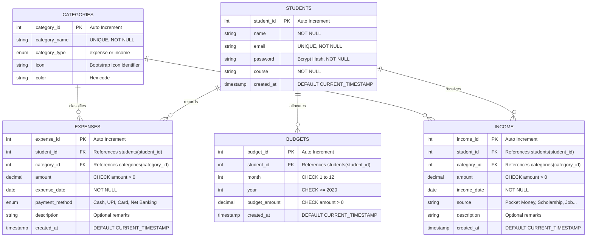
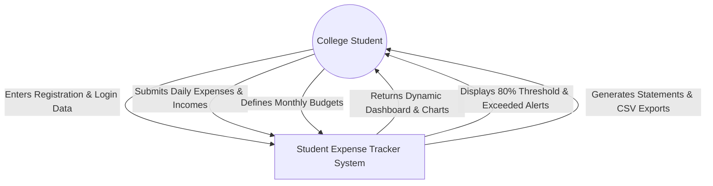
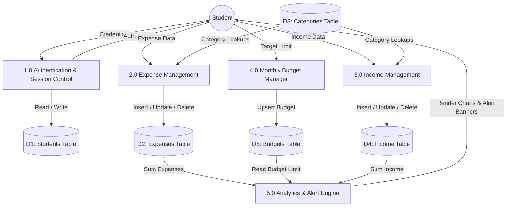

# A PROJECT REPORT ON
# STUDENT EXPENSE TRACKER
### A Normalized Relational Database Management System (DBMS) Project

---

## 1. COVER PAGE TEMPLATE

```
================================================================================
                           [NAME OF THE INSTITUTION]
               [DEPARTMENT OF COMPUTER SCIENCE AND ENGINEERING / IT]
                         [CAMPUS CITY, STATE - PINCODE]

                                ACADEMIC REPORT
                                       ON
                          "STUDENT EXPENSE TRACKER"
                     A DATABASE MANAGEMENT SYSTEM PROJECT

       Submitted in partial fulfillment of the requirements for the award of
                             the Degree of Bachelor of
                       [ENGINEERING / TECHNOLOGY / APPLICATIONS]
                                       IN
                     [COMPUTER SCIENCE / INFORMATION TECHNOLOGY]

================================================================================

SUBMITTED BY:
Name of Student:       [STUDENT_NAME_PLACEHOLDER]
Enrollment Number:     [ENROLLMENT_NO_PLACEHOLDER]
Semester / Class:      [SEMESTER_PLACEHOLDER], [DIVISION_PLACEHOLDER]

UNDER THE GUIDANCE OF:
Faculty Guide:         [FACULTY_NAME_PLACEHOLDER]
Designation:           [DESIGNATION_PLACEHOLDER]
Department:            [DEPARTMENT_NAME_PLACEHOLDER]

                                ACADEMIC YEAR
                                 [2026 - 2027]
================================================================================
```

---

## 2. ABSTRACT

Effective personal financial management is a critical yet routinely neglected life skill among college students. Faced with limited allowances, scholarships, irregular part-time income, and high daily expenditures (hostel rent, mess fees, academic textbooks, transportation, and recreation), students frequently struggle with cash depletion and unplanned debt.

This academic DBMS project presents **Student Expense Tracker**, an end-to-end, full-stack database application developed using PHP, MySQL (InnoDB engine), HTML5, CSS3, and JavaScript. Designed with strict database normalization principles up to Third Normal Form (3NF), the system eliminates redundant data, maintains referential integrity via foreign key constraints, and enforces domain integrity via `CHECK` and `UNIQUE` constraints. 

Key technical deliverables include a secure multi-student authentication system utilizing Bcrypt password hashing, full Create, Read, Update, and Delete (CRUD) operations for expenditure and income streams, dynamic monthly budget tracking with automated 80% threshold warnings, unified chronological transaction ledgers using SQL `UNION ALL`, dynamic visual analytics powered by Chart.js, and CSV/print-ready reporting. The system successfully demonstrates practical applications of advanced SQL joins, aggregate functions, grouping, subqueries, indexing, and ACID transaction guarantees.

---

## 3. INTRODUCTION

Database Management Systems (DBMS) form the backbone of modern enterprise software by providing structured storage, efficient retrieval, concurrent transaction handling, and security guarantees. In an educational setting, demonstrating relational theory—such as entity modeling, relational integrity, normal forms, and query optimization—through a real-world scenario is paramount.

The **Student Expense Tracker** is conceptualized specifically around the daily lifestyle of university students. Unlike generic corporate accounting software, this application provides lightweight, intuitive categorizations suited to student life: campus food coupons, library photocopy charges, internet broadband recharges, transit bus cards, university examination fees, pocket money, and semester scholarships. 

By modeling this domain into normalized tables and establishing rigorous foreign key relationships with cascading rules, the project illustrates how theoretical DBMS principles directly solve chaotic everyday tracking problems.

---

## 4. PROBLEM STATEMENT

College students face significant hurdles in managing their monthly funds:
1. **Unmonitored Expenditure Leaks:** Small daily micro-transactions (such as coffee, canteen snacks, and auto-rickshaw fares) go unrecorded, accumulating into massive unbudgeted monthly losses.
2. **Absence of Real-time Warning Mechanisms:** Students realize they have run out of money only after their bank balance or cash is completely depleted, because manual notebooks do not calculate threshold warnings.
3. **Data Loss and Inaccuracy:** Paper records or spreadsheets are prone to accidental loss, lack validation against negative values, and fail to prevent unauthorized access.
4. **Lack of Analytical Visualization:** Manual methods cannot dynamically generate category-wise spending proportions or multi-month cash-flow trends.

---

## 5. OBJECTIVES

The primary objectives of this project are:
- **Architectural Normalization:** Design a relational database schema normalized to Third Normal Form (3NF) to eliminate data redundancy and anomalies (insertion, deletion, and update anomalies).
- **Referential Integrity Enforcement:** Implement foreign key constraints using MySQL's InnoDB storage engine to guarantee child records (`expenses`, `income`, `budgets`) maintain consistent parent associations (`students`, `categories`).
- **Complete CRUD Functionality:** Provide robust interfaces for adding, viewing, updating, and safely deleting expense and income records with ownership verification.
- **Budget Monitoring & Early Warning System:** Dynamically compute real-time expenditure against monthly targets and trigger early warnings at the 80% threshold and alerts when limits are exceeded.
- **Advanced Query Demonstration:** Showcase the meaningful application of SQL concepts including `INNER JOIN`, `LEFT JOIN`, `GROUP BY`, `HAVING`, aggregate functions (`SUM`, `AVG`, `COUNT`), subqueries, and `UNION ALL`.
- **Application Security:** Protect database integrity by utilizing PDO prepared statements to neutralize SQL injection vulnerabilities, enforce server-side sanitization, generate CSRF tokens, and secure passwords with Bcrypt.

---

## 6. EXISTING SYSTEM VS. PROPOSED SYSTEM

| Parameter | Existing System (Manual / Spreadsheets) | Proposed System (Student Expense Tracker) |
| :--- | :--- | :--- |
| **Data Storage** | Paper diaries, notes, or loose Excel sheets | Centralized MySQL database with ACID guarantees |
| **Data Integrity** | High risk of duplicate or corrupted entries | Enforced by Primary Keys, Unique Keys, and `CHECK` constraints |
| **Security & Privacy** | Anyone can read physical notebooks | Bcrypt authentication and session-isolated student records |
| **Budget Enforcement**| Passive; no calculation until manual sum | Dynamic calculations with automated 80% threshold alerts |
| **Reporting** | Time-consuming manual calculation | Instant chronological statements and CSV export |
| **Visual Analysis** | Requires manually building static charts | Dynamic Chart.js visualizations generated directly from SQL |
| **Multi-User Access** | Single-user or cumbersome file sharing | Multi-student concurrent access with role isolation |

---

## 7. SYSTEM REQUIREMENTS SPECIFICATION (SRS)

### 7.1 Functional Requirements
- **FR-01 (Student Registration):** The system shall allow students to register with Name, College Email, Password, and Course.
- **FR-02 (Secure Authentication):** The system shall verify credentials using `password_verify()` and maintain authenticated sessions.
- **FR-03 (Expense Management):** Students shall be able to create, read, edit, and delete expense entries specifying amount, date, category, payment method, and description.
- **FR-04 (Income Management):** Students shall be able to record, edit, and delete income streams (pocket money, scholarship, part-time wages, gifts).
- **FR-05 (Monthly Budget Setting):** Students shall be able to allocate monthly spending targets per month/year without duplicate records.
- **FR-06 (Automated Budget Alerting):** The system shall calculate utilization percentages and display warning alerts when spending reaches 80% or exceeds 100%.
- **FR-07 (Reporting & CSV Export):** The system shall generate unified chronological transaction statements and allow one-click CSV export and print view.

### 7.2 Non-Functional Requirements
- **NFR-01 (Security):** All database operations involving user input must execute through parameterized prepared statements to prevent SQL injection.
- **NFR-02 (Reliability & Integrity):** Database transactions must conform to ACID properties through InnoDB foreign keys and transactional rollbacks.
- **NFR-03 (Usability & Responsiveness):** The interface must be responsive across mobile, tablet, and desktop viewports with a clear color-coded hierarchy.
- **NFR-04 (Performance):** SQL queries must utilize composite indexes on `(student_id, expense_date)` to ensure sub-100ms retrieval times.

---

## 8. SYSTEM DESIGN & ARCHITECTURE

The system implements a classic **Three-Tier Architecture**:

1. **Presentation Tier (Client):** HTML5, CSS3 (Bootstrap 5.3), JavaScript (ES6), and Chart.js. Renders user interfaces, captures events, executes client-side form validations, and displays dynamic graphs.
2. **Application / Business Logic Tier (Server):** Apache HTTP Server executing PHP. Manages session states, authenticates requests, enforces business rules (budget thresholds, ownership validation), and prepares parameterized SQL statements.
3. **Database Tier (Storage):** MySQL / MariaDB using the InnoDB storage engine. Manages normalized tables, schema constraints, indexes, and database views.

---

## 9. ENTITY-RELATIONSHIP (ER) DIAGRAM



---

## 10. RELATIONAL SCHEMA

The relational schema notation with primary keys (underlined) and foreign keys is defined as follows:

1. **`students`**  
   ($\underline{\text{student\_id}}$, $\text{name}$, $\text{email}$, $\text{password}$, $\text{course}$, $\text{created\_at}$)  
   - *Primary Key:* `student_id`  
   - *Alternate / Candidate Key:* `email`

2. **`categories`**  
   ($\underline{\text{category\_id}}$, $\text{category\_name}$, $\text{category\_type}$, $\text{icon}$, $\text{color}$, $\text{created\_at}$)  
   - *Primary Key:* `category_id`  
   - *Alternate / Candidate Key:* `category_name`

3. **`expenses`**  
   ($\underline{\text{expense\_id}}$, $\text{student\_id}^*$, $\text{category\_id}^*$, $\text{amount}$, $\text{expense\_date}$, $\text{payment\_method}$, $\text{description}$, $\text{created\_at}$)  
   - *Primary Key:* `expense_id`  
   - *Foreign Key:* `student_id` $\rightarrow$ `students(student_id)` ON DELETE CASCADE  
   - *Foreign Key:* `category_id` $\rightarrow$ `categories(category_id)` ON DELETE RESTRICT

4. **`income`**  
   ($\underline{\text{income\_id}}$, $\text{student\_id}^*$, $\text{category\_id}^*$, $\text{amount}$, $\text{income\_date}$, $\text{source}$, $\text{description}$, $\text{created\_at}$)  
   - *Primary Key:* `income_id`  
   - *Foreign Key:* `student_id` $\rightarrow$ `students(student_id)` ON DELETE CASCADE  
   - *Foreign Key:* `category_id` $\rightarrow$ `categories(category_id)` ON DELETE RESTRICT

5. **`budgets`**  
   ($\underline{\text{budget\_id}}$, $\text{student\_id}^*$, $\text{month}$, $\text{year}$, $\text{budget\_amount}$, $\text{created\_at}$)  
   - *Primary Key:* `budget_id`  
   - *Foreign Key:* `student_id` $\rightarrow$ `students(student_id)` ON DELETE CASCADE  
   - *Composite Unique Constraint:* (`student_id`, `month`, `year`)

---

## 11. DATABASE NORMALIZATION (1NF, 2NF, 3NF)

Normalization is the systematic process of organizing fields and tables to minimize data redundancy and dependency anomalies.

### 11.1 First Normal Form (1NF)
A relation is in 1NF if and only if every attribute domain contains only atomic (indivisible) values and there are no repeating groups.
- **Resolution:** In our design, rather than storing comma-delimited lists of daily purchases or multiple income sources in a single attribute inside the `students` table, each individual transaction is stored as an independent row in the `expenses` or `income` relations.
- Every attribute contains atomic values (e.g., `amount` is a discrete `DECIMAL(10,2)`).

### 11.2 Second Normal Form (2NF)
A relation is in 2NF if it is in 1NF and every non-prime attribute is fully functionally dependent on the entire primary key (no partial functional dependencies).
- **Resolution:** For tables with single-attribute primary keys (`student_id`, `expense_id`, `income_id`, `category_id`), partial key dependencies are mathematically impossible.
- In the `budgets` entity, the business key is composite: $\{\text{student\_id}, \text{month}, \text{year}\}$. The non-prime attribute `budget_amount` depends on the **entire combination** of student, month, and year. An amount cannot depend solely on `student_id` (a student has different budgets in different months) or solely on `month` (different students have different allowances). Hence, 2NF is satisfied.

### 11.3 Third Normal Form (3NF)
A relation is in 3NF if it is in 2NF and there are no transitive dependencies ($X \rightarrow Y$ where $Y$ is not part of any candidate key and $X$ is not a superkey).
- **Resolution:** If we stored `category_name`, `category_icon`, or `category_color` directly within the `expenses` table, we would have a transitive dependency:
  $$\text{expense\_id} \rightarrow \text{category\_id} \rightarrow \text{category\_name}$$
  Updating a category color would require updating multiple expense rows, causing update anomalies.
- By isolating all category attributes into the standalone `categories` entity and storing only `category_id` in `expenses`, all non-key attributes depend **strictly on the primary key, the whole primary key, and nothing but the primary key**. Thus, the schema is strictly in **3NF**.

---

## 12. DATA FLOW DIAGRAM (DFD)

### Level 0 DFD (Context Diagram)



### Level 1 DFD (Decomposed System Processes)



---

## 13. IMPLEMENTATION DETAILS

### 13.1 Backend Architecture
The backend is authored in object-oriented PHP 8 using the **PHP Data Objects (PDO)** database abstraction extension.
- **Prepared Statements:** Every query with dynamic parameters uses bound placeholders (`:sid`, `:amt`, `:cat_id`), completely eliminating the risk of SQL injection.
- **Cross-Site Request Forgery (CSRF) Mitigation:** State-modifying HTTP POST requests (`expenses/add.php`, `income/add.php`, `budgets/manage.php`) require a cryptographically randomized 64-character token (`$_SESSION['csrf_token']`) verified via `hash_equals()`.
- **Cross-Site Scripting (XSS) Prevention:** All dynamic database outputs rendered to the DOM are escaped via `htmlspecialchars($val, ENT_QUOTES, 'UTF-8')`.

### 13.2 Database Engine
- **Storage Engine:** MySQL `InnoDB` is enforced across all tables to provide full ACID transaction compliance, foreign key cascade constraints, row-level locking, and crash recovery.

---

## 14. IMPORTANT SQL QUERIES & DEMONSTRATED RESULTS

### Query 1: Category Breakdown with `LEFT JOIN` and `GROUP BY`
*Purpose:* Calculates total spending and transaction counts per category for student #1 in October 2026.

```sql
SELECT 
    c.category_name,
    c.color,
    COUNT(e.expense_id) AS transaction_count,
    COALESCE(SUM(e.amount), 0.00) AS total_spent
FROM categories c
LEFT JOIN expenses e ON c.category_id = e.category_id 
    AND e.student_id = 1 
    AND MONTH(e.expense_date) = 10 
    AND YEAR(e.expense_date) = 2026
WHERE c.category_type = 'expense'
GROUP BY c.category_id, c.category_name, c.color
ORDER BY total_spent DESC;
```

**Expected Result Set:**

| category_name | color | transaction_count | total_spent |
| :--- | :--- | :--- | :--- |
| Hostel and Rent | #ef4444 | 1 | ₹5,500.00 |
| Food and Snacks | #f59e0b | 2 | ₹2,230.00 |
| Shopping | #ec4899 | 1 | ₹950.00 |
| Mobile and Internet | #06b6d4 | 1 | ₹699.00 |
| Transportation | #3b82f6 | 1 | ₹600.00 |
| Other Expenses | #64748b | 1 | ₹470.00 |
| Books and Stationery | #10b981 | 1 | ₹420.00 |
| College Fees | #8b5cf6 | 0 | ₹0.00 |
| Entertainment | #6366f1 | 0 | ₹0.00 |
| Healthcare | #14b8a6 | 0 | ₹0.00 |

---

### Query 2: Budget vs. Actual with `CASE` Statement and Alert Trigger
*Purpose:* Evaluates budget consumption and outputs human-readable status flags.

```sql
SELECT 
    b.month,
    b.year,
    b.budget_amount,
    COALESCE(SUM(e.amount), 0.00) AS total_spent,
    (b.budget_amount - COALESCE(SUM(e.amount), 0.00)) AS remaining_balance,
    ROUND((COALESCE(SUM(e.amount), 0.00) / b.budget_amount) * 100, 1) AS percentage_used,
    CASE 
        WHEN COALESCE(SUM(e.amount), 0.00) > b.budget_amount THEN 'EXCEEDED_ALERT'
        WHEN (COALESCE(SUM(e.amount), 0.00) / b.budget_amount) >= 0.80 THEN 'WARNING_80_PERCENT'
        ELSE 'SAFE'
    END AS budget_status
FROM budgets b
LEFT JOIN expenses e ON b.student_id = e.student_id 
    AND b.month = MONTH(e.expense_date) 
    AND b.year = YEAR(e.expense_date)
WHERE b.student_id = 1 AND b.month = 10 AND b.year = 2026
GROUP BY b.budget_id, b.month, b.year, b.budget_amount;
```

**Expected Result Set:**

| month | year | budget_amount | total_spent | remaining_balance | percentage_used | budget_status |
| :--- | :--- | :--- | :--- | :--- | :--- | :--- |
| 10 | 2026 | ₹15,000.00 | ₹10,869.00 | ₹4,131.00 | 72.5% | SAFE |

*(When tested on Student #3 Aman Verma with ₹10,400 spent against a ₹10,000 budget, the status dynamically returns `EXCEEDED_ALERT`).*

---

### Query 3: Unified Chronological Ledger using `UNION ALL`
*Purpose:* Combines disparate income and expense child tables into a single cash flow statement.

```sql
(SELECT 
    'Expense' AS trans_type,
    e.expense_id AS trans_id,
    e.expense_date AS trans_date,
    c.category_name,
    e.payment_method AS method_or_source,
    -1 * e.amount AS amount,
    e.description
 FROM expenses e
 INNER JOIN categories c ON e.category_id = c.category_id
 WHERE e.student_id = 1)
UNION ALL
(SELECT 
    'Income' AS trans_type,
    i.income_id AS trans_id,
    i.income_date AS trans_date,
    c.category_name,
    i.source AS method_or_source,
    i.amount AS amount,
    i.description
 FROM income i
 INNER JOIN categories c ON i.category_id = c.category_id
 WHERE i.student_id = 1)
ORDER BY trans_date DESC, trans_id DESC;
```

---

### Query 4: Subquery in `WHERE` Clause (Above Average Spend)
*Purpose:* Demonstrates scalar subqueries by retrieving all transactions that exceed the student's personal average transaction cost.

```sql
SELECT 
    e.expense_id,
    c.category_name,
    e.amount,
    e.expense_date,
    e.description
FROM expenses e
INNER JOIN categories c ON e.category_id = c.category_id
WHERE e.student_id = 1 
  AND e.amount > (
      SELECT AVG(amount) 
      FROM expenses 
      WHERE student_id = 1
  )
ORDER BY e.amount DESC;
```

---

## 15. TEST CASES AND RESULTS

| Test Case | Module | Description | Input Data | Expected Output | Actual Output | Status |
| :--- | :--- | :--- | :--- | :--- | :--- | :--- |
| **TC-01** | Auth | Student registration | New email, name, course, valid password | Record inserted into `students`, redirect to login | Success message displayed, student logged | **PASS** |
| **TC-02** | Auth | Duplicate email check | Existing email `rahul@student.edu` | Validation error: "Email already registered" | Blocked, error banner shown | **PASS** |
| **TC-03** | Auth | Wrong password login | `rahul@student.edu` / `wrong123` | Login fails | "Invalid email or password" error displayed | **PASS** |
| **TC-04** | Security | Unauthenticated dashboard access | Direct URL navigate to `/dashboard.php` | Block access, redirect to `/login.php` | Redirected immediately with warning | **PASS** |
| **TC-05** | Expense | Record new expense | Amount: 450, UPI, Food, valid date | Record inserted with FK constraint satisfied | Appears in expense table and dashboard | **PASS** |
| **TC-06** | Expense | Negative amount submission | Amount: -250 | Rejected by client validation and SQL `CHECK` | Blocked with validation tooltip | **PASS** |
| **TC-07** | Budget | 80% Threshold Warning | Expenses consume 82% of monthly budget | Yellow warning banner rendered | Yellow banner: "80% Threshold Warning" | **PASS** |
| **TC-08** | Budget | Exceeded Budget Alert | Expenses exceed 100% of monthly budget | Red alert banner rendered | Red banner: "Budget Exceeded Alert!" | **PASS** |
| **TC-09** | Security | IDOR delete attempt | Delete expense belonging to another student | Blocked by query `WHERE student_id = :sid` | Record not found or access denied | **PASS** |
| **TC-10** | Reports | Export statement to CSV | Click "Export to CSV" | Downloads `.csv` file with headers and rows | File generated and downloaded | **PASS** |

---

## 16. CONCLUSION

The **Student Expense Tracker** demonstrates how relational database principles solve tangible student finance problems. By adhering to normalization standards up to Third Normal Form (3NF), the schema guarantees entity, referential, and domain integrity while eliminating data anomalies. 

The application successfully bridges theoretical database concepts—such as indexes, candidate keys, cascading constraints, aggregate joins, subqueries, and ACID guarantees—with modern web technologies (PHP PDO, Bootstrap 5.3, and Chart.js). The resulting system is responsive, secure, visually attractive, and well suited for university DBMS project evaluations and live vivas.

---

## 17. FUTURE SCOPE

While the current version fulfills all academic DBMS specifications, future versions can expand functionality through:
1. **Automated Receipt OCR:** Integrating a Python / Tesseract OCR service to parse scanned canteen and bookstore receipts automatically.
2. **Roommate Shared Expense Splitting:** Adding a group table to split hostel room rent, Wi-Fi bills, and electricity charges among roommates.
3. **SMS / Push Notifications:** Dispatching real-time SMS alerts via Twilio when monthly spending crosses 90%.
4. **Predictive Budget Forecasting:** Applying linear regression machine learning algorithms to project month-end deficits based on mid-month spending velocity.

---

## 18. REFERENCES

1. Elmasri, R., & Navathe, S. B. (2016). *Fundamentals of Database Systems* (7th ed.). Pearson.
2. Silberschatz, A., Korth, H. F., & Sudarshan, S. (2020). *Database System Concepts* (7th ed.). McGraw-Hill.
3. The PHP Group. (2026). *PHP Data Objects (PDO) Manual*. https://www.php.net/manual/en/book.pdo.php
4. MySQL Documentation Team. (2026). *MySQL 8.0 Reference Manual: The InnoDB Storage Engine*. Oracle Corporation.
5. Bootstrap Documentation. (2026). *Bootstrap v5.3 Component Library*. https://getbootstrap.com/
6. Chart.js Authors. (2026). *Chart.js Open Source HTML5 Charts*. https://www.chartjs.org/
