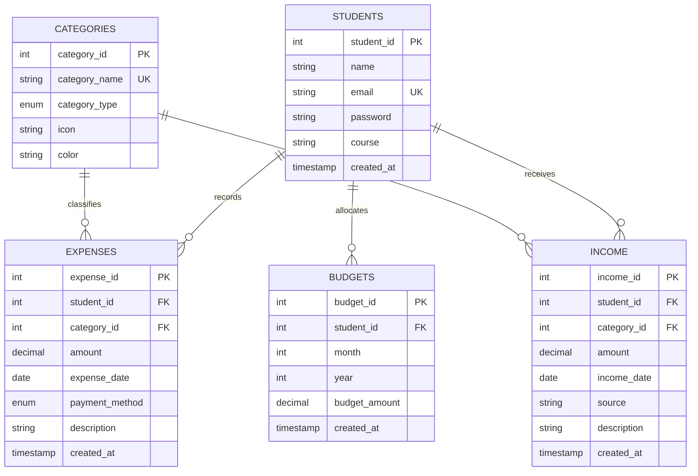

# Student Expense Tracker — College DBMS Project

> **A Complete Relational Database Management System Web Application for College Students**  
> **Academic Subject:** Database Management Systems (DBMS)  
> **Technology Stack:** HTML5, CSS3, JavaScript, PHP (PDO), MySQL (InnoDB), Apache (XAMPP)

---

## 1. Project Introduction

College life introduces students to independent financial management for the first time. Balancing monthly parental allowances, scholarships, semester book expenses, canteen lunches, hostel rent, and transit fees often leads to unexpected deficits before the month ends.

**Student Expense Tracker** is a full-featured, normalized relational database web application designed to empower college students to record, categorize, track, and analyze their daily income and expenditures. The system provides real-time budget tracking, dynamic category analytics, automated 80% spending threshold warnings, and downloadable financial reports.

---

## 2. Problem Statement

Most college students manage personal finances informally using memory, paper notebooks, or basic mobile notes. These approaches suffer from:
1. **Lack of Category Awareness:** Inability to pinpoint where money disappears (e.g., food vs. entertainment).
2. **No Budget Enforcement:** Zero real-time warnings when nearing spending limits, leading to monthly overspending.
3. **Absence of Historical Record:** Inability to review historical semester cash flows or produce statements for parents or scholarship audits.
4. **Data Redundancy & Chaos:** Lack of relational normalization, making manual summaries error-prone.

---

## 3. Project Objectives

- **Relational Integrity:** Implement a strictly normalized 3NF relational schema in MySQL ensuring entity and referential integrity.
- **Full CRUD Functionality:** Allow students to create, read, update, and delete daily expense and income records.
- **Budget Threshold Alerts:** Dynamically compare monthly expenses against student-defined budgets, triggering alerts when spending reaches 80% or exceeds 100%.
- **Analytics & Visualizations:** Render dynamic spending distributions and 6-month trends using Chart.js.
- **Secure Architecture:** Prevent SQL injection via PDO prepared statements, implement Bcrypt password hashing, CSRF protection, and session authorization.
- **Academic Reporting:** Generate print-friendly statements and export filtered logs to CSV.

---

## 4. Hardware and Software Requirements

### Hardware Requirements
- **Processor:** Intel Core i3 / AMD Ryzen 3 or higher.
- **Memory (RAM):** Minimum 4 GB (8 GB recommended).
- **Storage:** 200 MB free hard drive space.
- **Display:** 1280x720 minimum screen resolution.

### Software Requirements
- **Operating System:** Windows 10/11, macOS, or Linux.
- **Web Server:** Apache HTTP Server 2.4+ (bundled with XAMPP).
- **Database Server:** MySQL 8.0+ or MariaDB 10.4+ (InnoDB engine).
- **Backend Language:** PHP 7.4 to 8.4 with PDO and `pdo_mysql` extensions enabled.
- **Web Browser:** Google Chrome, Mozilla Firefox, Microsoft Edge, or Safari.

---

## 5. Technology Stack

| Layer | Technology | Purpose |
| :--- | :--- | :--- |
| **Frontend** | HTML5, CSS3, Bootstrap 5.3 | Responsive semantic layout and styling |
| **Icons** | Bootstrap Icons 1.11 | High-contrast visual symbols |
| **Visualizations** | Chart.js 4.4 | Dynamic doughnut category charts and monthly trend bars |
| **Client Scripting** | Vanilla JavaScript (ES6) | Real-time form validation and drawer controls |
| **Backend** | PHP 8.x (Object-Oriented PDO) | Server-side routing, auth, business logic, sanitization |
| **Database** | MySQL / MariaDB (InnoDB) | 3NF normalized tables, foreign keys, indexes, views |
| **Environment** | XAMPP | Local Apache web server and MySQL database daemon |

---

## 6. System Architecture

```
+----------------------------------------------------------------+
|                        Client Browser                          |
|        (HTML5, Responsive CSS3 Grid/Flexbox, Chart.js)        |
+----------------------------------------------------------------+
                               |  HTTP / HTTPS (Forms & AJAX)
                               v
+----------------------------------------------------------------+
|                       Apache Web Server                        |
|   +--------------------------------------------------------+   |
|   |                       PHP Engine                       |   |
|   |  - Session-based Auth & Access Control (auth.php)      |   |
|   |  - CSRF Verification & XSS Sanitization (functions.php)|   |
|   |  - Expense, Income, Budget Controller Modules          |   |
|   |  - PDO Prepared Statements Driver (db.php)             |   |
|   +--------------------------------------------------------+   |
+----------------------------------------------------------------+
                               |  TCP / Port 3306 (PDO MySQL)
                               v
+----------------------------------------------------------------+
|                   MySQL Database (InnoDB Engine)               |
|   - students       (Primary Keys, Unique Hashed Emails)       |
|   - categories     (Standardized Dimensions: Expense/Income)   |
|   - expenses       (Foreign Keys, Amount Check, Date Indexes)  |
|   - income         (Foreign Keys, Inflow Streams)              |
|   - budgets        (Composite Unique Keys: Student+Month+Year) |
|   - View: v_student_monthly_overview                           |
+----------------------------------------------------------------+
```

---

## 7. Database Design & Entity Relationship (ER) Diagram

### Tables & Key Attributes

1. **`students`**
   - `student_id` (INT, PK, AUTO_INCREMENT)
   - `name` (VARCHAR(100), NOT NULL)
   - `email` (VARCHAR(120), UNIQUE, NOT NULL, CHECK email format)
   - `password` (VARCHAR(255), NOT NULL, Bcrypt hash)
   - `course` (VARCHAR(100), NOT NULL)
   - `created_at` (TIMESTAMP)

2. **`categories`**
   - `category_id` (INT, PK, AUTO_INCREMENT)
   - `category_name` (VARCHAR(60), UNIQUE, NOT NULL)
   - `category_type` (ENUM('expense', 'income'), NOT NULL)
   - `icon` (VARCHAR(50))
   - `color` (VARCHAR(25))

3. **`expenses`**
   - `expense_id` (INT, PK, AUTO_INCREMENT)
   - `student_id` (INT, FK -> `students.student_id` ON DELETE CASCADE)
   - `category_id` (INT, FK -> `categories.category_id` ON DELETE RESTRICT)
   - `amount` (DECIMAL(10,2), NOT NULL, CHECK amount > 0)
   - `expense_date` (DATE, NOT NULL)
   - `payment_method` (ENUM('Cash', 'UPI / Online', 'Debit Card', 'Credit Card', 'Net Banking', 'Other'))
   - `description` (VARCHAR(255))
   - `created_at` (TIMESTAMP)

4. **`income`**
   - `income_id` (INT, PK, AUTO_INCREMENT)
   - `student_id` (INT, FK -> `students.student_id` ON DELETE CASCADE)
   - `category_id` (INT, FK -> `categories.category_id` ON DELETE RESTRICT)
   - `amount` (DECIMAL(10,2), NOT NULL, CHECK amount > 0)
   - `income_date` (DATE, NOT NULL)
   - `source` (VARCHAR(100), NOT NULL)
   - `description` (VARCHAR(255))
   - `created_at` (TIMESTAMP)

5. **`budgets`**
   - `budget_id` (INT, PK, AUTO_INCREMENT)
   - `student_id` (INT, FK -> `students.student_id` ON DELETE CASCADE)
   - `month` (TINYINT, NOT NULL, CHECK 1-12)
   - `year` (SMALLINT, NOT NULL, CHECK >= 2020)
   - `budget_amount` (DECIMAL(10,2), NOT NULL, CHECK amount > 0)
   - `created_at` (TIMESTAMP)
   - `UNIQUE KEY (student_id, month, year)`

### ER Diagram (Mermaid)



---

## 8. Database Normalization (Up to 3NF)

1. **First Normal Form (1NF):**
   - All columns contain atomic, indivisible values.
   - Repeating groups (e.g., storing multiple expense amounts in a comma-separated field) have been eliminated by creating separate rows in the `expenses` and `income` child tables.
   - Each table possesses an explicit primary key (`student_id`, `category_id`, `expense_id`, `income_id`, `budget_id`).

2. **Second Normal Form (2NF):**
   - The database complies with 1NF.
   - All non-key attributes are fully functionally dependent on the entire primary key. In tables with composite business keys like `budgets` (`student_id`, `month`, `year`), every column depends on the complete composite tuple, preventing partial key dependencies.

3. **Third Normal Form (3NF):**
   - The database complies with 2NF.
   - There are zero transitive dependencies. Non-key attributes depend only on the primary key ($X \rightarrow Y$ where $X$ is a superkey). For example, rather than storing category descriptions or colors within the `expenses` table, they reside in a standalone `categories` lookup table referenced via foreign key `category_id`.

---

## 9. Meaningful DBMS Concepts Demonstrated

| Concept | Implementation in Project |
| :--- | :--- |
| **DDL (Data Definition)** | `CREATE TABLE`, `ALTER TABLE`, constraints (`CHECK`, `UNIQUE`, `NOT NULL`, `DEFAULT`) |
| **DML (Data Manipulation)** | `INSERT INTO`, `SELECT`, `UPDATE`, `DELETE` parameterized queries |
| **Joins** | `INNER JOIN` (linking expenses to categories/students), `LEFT JOIN` (calculating category totals even with 0 expenses) |
| **Aggregation & Grouping** | `SUM()`, `COUNT()`, `AVG()`, `ROUND()`, `GROUP BY`, and `HAVING SUM(amount) > threshold` |
| **Subqueries** | Correlated subqueries and subqueries in `WHERE` to isolate expenses above student average |
| **Set Operations** | `UNION ALL` combining `expenses` and `income` tables into a unified chronological financial ledger |
| **ACID Transactions** | `$pdo->beginTransaction()`, `$pdo->commit()`, and `$pdo->rollBack()` during registration and budget adjustments |
| **Indexes** | B-Tree indexes on `(student_id, expense_date)` and `(student_id, income_date)` for fast query lookups |
| **Database View** | `v_student_monthly_overview` pre-aggregating monthly income, expenses, and budget balances |

---

## 10. Project Directory Structure

```
Student_Expense_Tracker/
├── index.php                 # Public landing page with demo account card
├── register.php              # Student registration form with course & password hashing
├── login.php                 # Student login with demo credentials autofill
├── logout.php                # Session destruction and safe redirect
├── dashboard.php             # Core KPI dashboard, dynamic charts, and budget alert banners
├── profile.php               # Student account settings and password update
│
├── expenses/
│   ├── add.php               # Record new expense
│   ├── view.php              # Filter, search, and view all student expenses
│   ├── edit.php              # Modify existing expense with ownership validation
│   └── delete.php            # Secure deletion with CSRF token
│
├── income/
│   ├── add.php               # Record student income/allowance
│   ├── view.php              # Search and view income history
│   ├── edit.php              # Edit existing income entry
│   └── delete.php            # Delete income entry
│
├── budgets/
│   ├── manage.php            # Set or update monthly budget (INSERT ON DUPLICATE KEY UPDATE)
│   └── view.php              # Historical monthly budgets comparison with utilization bars
│
├── reports/
│   ├── index.php             # Chronological statement (UNION ALL), category summaries & print view
│   └── export_csv.php        # Download filtered transaction statement as Excel-friendly CSV
│
├── includes/
│   ├── db.php                # PDO connection with auto-initialization & error handling
│   ├── functions.php         # Sanitization, CSRF, flash alerts, and budget calculators
│   ├── auth.php              # Session auth guards and password verification
│   ├── header.php            # Universal top navbar, styles, and Chart.js imports
│   ├── sidebar.php           # Sidebar navigation with active route highlights
│   └── footer.php            # Footer scripts and closing tags
│
├── assets/
│   ├── css/
│   │   └── style.css         # Modern financial dashboard theme with print styling
│   ├── js/
│   │   └── script.js         # Mobile drawer toggle, client validation, Chart.js initializers
│   └── images/
│
├── database/
│   ├── schema.sql            # Normalized DDL script (tables, constraints, view)
│   ├── sample_data.sql       # Rich college dataset with 3 students and 30+ transactions
│   └── useful_queries.sql    # Advanced SQL viva query demonstrations with explanations
│
├── DBMS_REPORT.md            # Formal academic college DBMS project report
└── README.md                 # Project documentation and guide
```

---

## 11. Installation and Execution Instructions (XAMPP)

### Step 1: Install & Launch XAMPP
1. Download and install **XAMPP** from [apachefriends.org](https://www.apachefriends.org/).
2. Open the **XAMPP Control Panel**.
3. Start the **Apache** and **MySQL** modules (confirm both turn green).

### Step 2: Place the Project in `htdocs`
1. Copy or symlink the project folder into your XAMPP web root:
   - Default path on Windows: `C:\xampp\htdocs\Student_Expense_Tracker`
2. Alternatively, if running directly from this directory via PHP's built-in development server:
   ```powershell
   php -S localhost:8000
   ```

### Step 3: Database Setup
1. Open your browser and navigate to **phpMyAdmin**:  
   `http://localhost/phpmyadmin/`
2. Create a new database named **`student_expense_tracker`** with collation `utf8mb4_unicode_ci`.
3. Click on the **Import** tab:
   - Choose and import `database/schema.sql`
   - Choose and import `database/sample_data.sql`
4. *(Note: The application's `includes/db.php` also features automatic database and table initialization if MySQL is active).*

### Step 4: Access the Application
1. In your web browser, navigate to:  
   `http://localhost/Student_Expense_Tracker/` (or `http://localhost:8000/`)
2. Click **Launch Tracker** or **Login**.

---

## 12. Pre-loaded Sample Credentials for Testing & Viva

| Role | Student Name | Email Address | Password | Course |
| :--- | :--- | :--- | :--- | :--- |
| **Demo Student** | **Rahul Sharma** | `rahul@student.edu` | `student123` | B.Tech CSE (Contains 3 months of data, budget alerts, and category records) |
| **Student 2** | **Priya Patel** | `priya@student.edu` | `student123` | BCA |
| **Student 3** | **Aman Verma** | `aman@student.edu` | `student123` | B.Sc IT (Pre-configured Over-Budget test case) |

*(You can also click the **"Auto-fill"** button on the login screen to populate these credentials instantly).*

---

## 13. System Testing & Test Cases

| Test Case ID | Module | Scenario | Input Data | Expected Result | Pass/Fail |
| :--- | :--- | :--- | :--- | :--- | :--- |
| **TC-01** | Auth | Register with unique email | Valid details | Account created, redirected to login | **PASS** |
| **TC-02** | Auth | Register with duplicate email | `rahul@student.edu` | Blocked with "Email already registered" alert | **PASS** |
| **TC-03** | Auth | Login with incorrect password | `wrongpass` | Blocked with "Invalid email or password" | **PASS** |
| **TC-04** | Security | Direct URL access without login | Access `/dashboard.php` | Blocked and redirected to `/login.php` | **PASS** |
| **TC-05** | Expense | Add expense with valid data | Amount: ₹450, UPI, Food | Record inserted, total expense updated | **PASS** |
| **TC-06** | Expense | Add expense with negative amount | Amount: -100 | Rejected by client and SQL `CHECK` constraint | **PASS** |
| **TC-07** | Budget | Monthly spend reaches ≥ 80% | Expenses ≥ 80% of budget | Yellow threshold warning alert rendered | **PASS** |
| **TC-08** | Budget | Monthly spend exceeds 100% | Expenses > budget limit | Red exceeded-budget alert displayed | **PASS** |
| **TC-09** | Security | IDOR modification of other student | Edit expense of other ID | Blocked with access denied error | **PASS** |
| **TC-10** | Report | Export transaction history | Click "Export to CSV" | Browser downloads `.csv` spreadsheet file | **PASS** |

---

## 14. Limitations and Future Enhancements

### Limitations
- Multi-currency conversion is not included (fixed to INR ₹).
- Receipts and bills cannot be uploaded as PDF/image attachments currently.
- SMS / Email notifications for over-budget alerts are not integrated.

### Future Enhancements
- **OCR Receipt Scanning:** Implement machine learning to extract amount and category directly from photo uploads of paper canteen/shop receipts.
- **Splitwise-Style Roommate Splitting:** Allow roommates to divide shared hostel electricity or grocery expenses.
- **Push / WhatsApp Alerts:** Automated WhatsApp alerts sent when approaching 90% of the monthly allowance.
